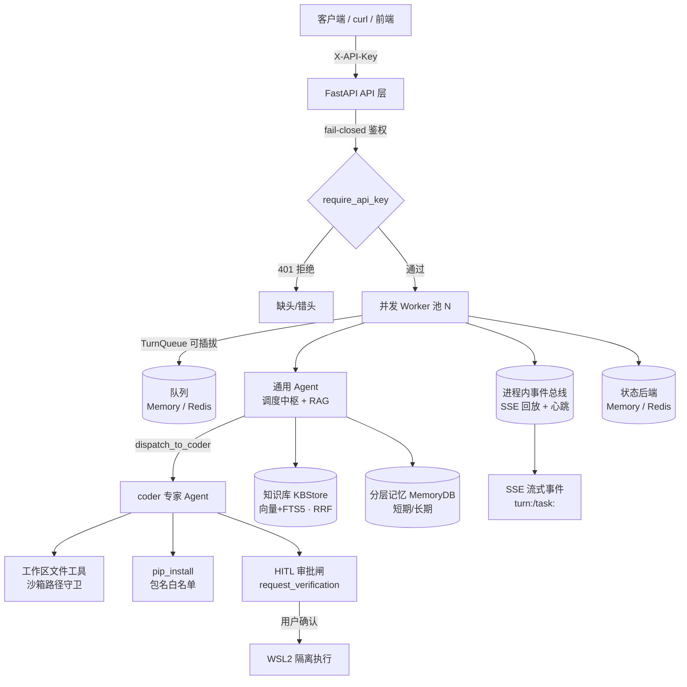

# Agent Pro

分阶段自研的**多智能体调度应用**（v0.1 → v1.0，生产就绪并发改造）。采用 **Agent-as-Tool 范式 + Supervision 架构**：通用 Agent 作调度中枢，按需把"写代码"类任务 handoff 给 coder 专家 Agent，并通过 RAG 知识库、分层记忆、代码隔离沙箱、HITL 审批闸、SSE 事件总线与可观测体系，实现多 Agent 任务闭环。

> 版本现状：**v1.0.1 已提交**。详见 [`docs/CHANGELOG.md`](docs/CHANGELOG.md)。

---

## 一、架构



**核心数据流**：客户端 POST 一条消息 → 经鉴权进入 `TurnWorker` 的队列 → N 个并发消费者各起一个线程执行一个 turn（通用 Agent 流式推理）→ 工具调用/中间状态经事件总线推到对应 SSE 话题 → 终态写入状态后端（重启可恢复）。

---

## 二、功能特性

- **多 Agent 调度**：通用 Agent 识别意图，仅把"产出可运行代码"类任务 handoff 给 coder 专家；coder 在工作区落地真实文件。
- **并发执行**：单进程 N 并发 worker 池（默认 4，可配），真正并行；per-turn 超时 + 单 turn 异常不拖垮整体。
- **RAG 混合检索**：结构感知分块（保留标题溯源路径）+ `BM25(FTS5) + 向量` 的 RRF 融合；Embedding 缺失自动降级纯全文检索。
- **分层记忆**：短期随对话滚动压缩；长期按实体/事实落盘，跨会话召回。
- **代码隔离沙箱**：工作区路径守卫（挡绝对路径/`../`/符号链接）；coder 自验经 **HITL 审批闸**在 **WSL2** 隔离执行，绝不静默回退宿主机。
- **可观测**：结构化 JSON 日志 + 轮转 + 全链路上下文追踪 + Token/成本核算。
- **稳定性**：可插拔 Memory/Redis 队列与状态后端，Redis 不可用自动降级内存，启动不阻塞；SSE 回放 + Last-Event-ID 重连 + 心跳 + 终态兜底。

---

## 三、环境要求

| 项目 | 要求 |
|---|---|
| OS | Windows（WSL2 沙箱）/ Linux / macOS |
| Python | ≥ 3.10（推荐 3.12） |
| 包管理 | [uv](https://github.com/astral-sh/uv)（构建/运行） |
| LLM | OpenAI 兼容网关（默认 DeepSeek，通过 `.env` 配置） |
| 可选 | Redis（持久化队列/状态）、WSL2（代码执行沙箱）、Embedding 服务（向量检索） |

---

## 四、安装

```bash
# 1) 克隆
git clone <your-repo-url> agent-pro && cd agent-pro

# 2) 用 uv 创建虚拟环境并安装依赖（含 dev: pytest / ruff）
uv sync --extra dev          # 或: uv sync（仅运行依赖）

# 3) 准备配置
cp .env.example .env
#   然后编辑 .env: 至少填 API_AUTH_KEY（非空，否则服务拒绝启动）与 LLM 凭据
```

> 已生成 `uv.lock`，依赖版本可复现。

---

## 五、配置（`.env` 关键项）

| 变量 | 说明 | 默认/建议 |
|---|---|---|
| `API_AUTH_KEY` | **必填**，非空；空值服务拒绝启动 | 改成足够长随机串 |
| `OPENAI_API_KEY` | LLM 密钥 | — |
| `OPENAI_BASE_URL` | LLM 网关 | DeepSeek 等 |
| `MODEL_NAME` | 模型名 | `deepseek-chat` 等 |
| `API_HOST` | 绑定地址 | `127.0.0.1`（本机）/ `0.0.0.0`（**仅内网/反代后**） |
| `API_PORT` | 端口 | `8000` |
| `WORKER_CONCURRENCY` | 并发 turn 数 | `4`（资源/配额够可上 100） |
| `TURN_TIMEOUT_S` | 单 turn 超时 | `600` |
| `QUEUE_BACKEND` | `auto`/`redis`/`memory` | `auto` |
| `QUEUE_MAXSIZE` | 队列上限（背压，满则 429） | `1000` |
| `REDIS_URL` | 状态/队列持久化后端 | 空=默认 `redis://localhost:6379`（不可用降级内存） |
| `KB_DIR` | 知识库文档目录 | `./knowledge` |
| `EMBEDDING_MODEL` | 留空=降级纯 FTS5 | 如 `BAAI/bge-m3` |
| `LOG_LEVEL` / `LOG_DIR` | 日志级别 / 目录 | `INFO` / `./logs` |

---

## 六、知识库准备（可选但推荐）

把 Markdown / txt 文档放进 `knowledge/`，然后导入：

```bash
uv run python -m agent_pro.kb import     # 按文档增量替换（幂等）
uv run python -m agent_pro.kb stats      # 查看索引统计
uv run python -m agent_pro.kb search "关键词"   # 调试检索
# uv run python -m agent_pro.kb reindex  # 清空重建
```

> 未配置 Embedding 时检索自动降级为纯全文检索，仍可正常溯源。

---

## 七、启动

### 7.1 API 服务（推荐，生产形态）

```bash
uv run python -m agent_pro.api
# 或用 venv 直接: .venv/Scripts/python.exe -m agent_pro.api   (Windows)
```

启动后：
- `GET  /health` —— 健康检查（无需鉴权）
- `POST /api/sessions` —— 新建会话，返回 `session_id`
- `POST /api/sessions/{id}/chat` —— 提交一条消息，返回 `turn_id`
- `GET  /api/chat/turns/{turn_id}` —— 轮次状态/结果
- `GET  /api/chat/turns/{turn_id}/events` —— **SSE** 实时事件流（轮次）
- `GET  /api/sessions/{id}/history` —— 会话历史
- `POST /api/turns/{turn_id}/approve` —— **HITL** 执行审批（自验命令）
- `GET  /api/tasks/{task_id}` / `.../events` —— 任务进度（SSE）

### 7.2 CLI（交互式，单人）

```bash
uv run python main.py --new        # 新会话
uv run python main.py --session <id>   # 续聊
```

---

## 八、使用（curl 示例）

```bash
BASE=http://127.0.0.1:8000
KEY=你的API_AUTH_KEY

# 1) 新建会话
SID=$(curl -s -X POST "$BASE/api/sessions" -H "X-API-Key: $KEY" | python -c "import sys,json;print(json.load(sys.stdin)['session_id'])")
echo "session=$SID"

# 2) 提交消息（立即返回 turn_id）
TID=$(curl -s -X POST "$BASE/api/sessions/$SID/chat" -H "X-API-Key: $KEY" \
  -H "Content-Type: application/json" \
  -d '{"message":"用 Python 写一个命令行待办应用"}' \
  | python -c "import sys,json;print(json.load(sys.stdin)['turn_id'])")

# 3) 拉轮次结果（轮询，或直接走 SSE）
curl -s "$BASE/api/chat/turns/$TID" -H "X-API-Key: $KEY"

# 4) SSE 实时事件流（推荐：工具调用/进度/终态逐条推送）
curl -N "$BASE/api/chat/turns/$TID/events" -H "X-API-Key: $KEY"

# 5) 若 coder 发起自验，先查是否有待审批请求，再决定通过/拒绝
curl -s "$BASE/api/turns/$TID/approve" -X POST -H "X-API-Key: $KEY" \
  -H "Content-Type: application/json" -d '{"approve":true,"comment":"允许在沙箱执行测试"}'
```

**SSE 事件类型**：`tool_call` / `tool_result` / `approval_request` / `final` / `error`（终态事件到达后流自动关闭；支持 `Last-Event-ID` 重连与晚连接回放）。

---

## 九、评测（真实命中率）

内置黄金集评测 RAG 引用命中率（是否真的可溯源）：

```bash
uv run python -m agent_pro.eval.runner
```

输出示例：`[Eval] 共12条 | 已回答12 | 引用命中11 | 引用命中率92% | 平均延迟12.2s | 成本N/A`

> 数据集见 `eval/gold_dataset.json`；评测会按需自动导入 `knowledge/`。

---

## 十、生产部署建议

当前为**单进程服务**（`workers=1`，队列与事件总线在进程内存）。上生产前建议：

1. **放置反向代理**：Nginx / Caddy 前置，负责 **TLS(HTTPS)**、域名、静态与超时；本项目**不处理 HTTPS**。
2. **限流**：在反代层按 key/IP 限流；应用层已有队列背压（`QUEUE_MAXSIZE` → 429）。
3. **绑定地址**：`API_HOST=0.0.0.0` 仅在内网或反代后使用；公网务必前置鉴权与限流。
4. **持久化（可选）**：装 Redis 并设 `REDIS_URL`，使队列/状态跨重启不丢（本环境已验证内存降级路径，Redis 路径需在装 Redis 环境复核）。
5. **进程守护**：用 systemd / supervisor / 容器 管理 `python -m agent_pro.api` 进程，配合 `/health` 做存活探针。
6. **密钥管理**：`.env` 已 gitignore；生产用环境变量或密钥注入，勿明文进仓库。

---

## 十一、安全模型

- **鉴权**：`X-API-Key` fail-closed；空 `API_AUTH_KEY` 拒绝启动；缺头/错头均 401。
- **文件沙箱**：所有工作区路径经 `WorkspaceSandbox.resolve_safe` 校验，拦截绝对路径、`../` 穿越、符号链接逃逸。
- **依赖安装**：`pip_install` 用列表参数（无 shell）、包名正则白名单（拦 `-e`/`--index-url`/注入）、数量/超时/输出截断。
- **代码执行**：经 HITL 审批后在 **WSL2** 隔离执行，超时强杀；绝不在宿主机静默执行。
- **信息脱敏**：对外错误文案不含内部路径/堆栈，仅留追踪码，详情落服务端日志。
- **SQL**：全部参数化，无注入面。

---

## 十二、开发与测试

```bash
uv sync --extra dev        # 安装 pytest / ruff
uv run ruff check src      # 静态检查
uv run pytest -q           # 全量测试（含并发 + 安全回归）
```

测试覆盖：`tests/test_v1_concurrency.py`（队列顺序 / worker 并行 / 每线程连接并发读写）、`tests/test_security.py`（沙箱穿越拦截 / pip 白名单 / API 鉴权 401 / 队列背压 / 错误脱敏 / turn 回收）。

---

## 十三、Git 发布流程与版本规范

本项目遵循**决策先行**协作约定（见 `docs/CHANGELOG.md`）：

1. **每个版本先梳理「关键决策点」**（含优缺点）交用户拍板，再写执行方案（`docs/plans/vX.Y-execution-plan.md`）与 CHANGELOG 条目。
2. **功能落地后由助手直接提交**：用**精确 `git add <路径>`**（严禁 `git add -A`/`.`），避免 `data/`、`*.log`、`body.json`、`workspace/`、`.env` 等运行时产物误入。
3. **版本号**随 `pyproject.toml` 与 `src/agent_pro/__init__.py` 同步推进（当前 `1.0.0`）。
4. **CHANGELOG** 每条版本记录：目标 / 决策 / 变更 / 实测 / 已知边界。

典型发布命令（仓库内）：

```bash
git add pyproject.toml src/agent_pro/__init__.py src/agent_pro/... tests/... docs/...
git commit -m "v1.0.0 ..."
git tag v1.0.0 && git push && git push --tags
```

> 提交前确认 `git status` 不含 `data/`、`*.log`、`body.json`、`workspace/`、`.env`。

---

## 十四、已知边界 / 路线图

- **共享 venv**：并行 coder 的 pip 安装经全局锁串行；运行时仍共用同一环境（互斥依赖冲突为已知债务，未来可改 per-task venv）。
- **真·100 并发**取决于 DeepSeek RPM/TPM 与单机资源；worker 池已支撑可配置并行。
- **向量检索**需自部署 Embedding 服务；未配则降级纯 FTS。
- **知识库增量监听更新**、**长期记忆语义去重**、**更细粒度权限注册**列为后续版本。
- **成本统计**对未在 `MODEL_PRICING` 登记的模型显示 `N/A`（仅记 token，不估费）。
